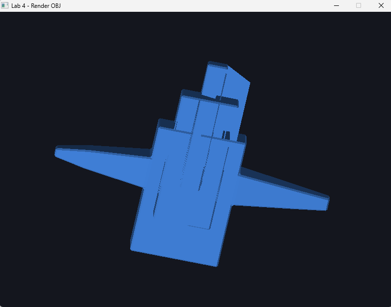

# Lab 4 - Renderizado de Modelo OBJ

Renderizado manual de un modelo 3D en formato OBJ utilizando C++, SDL2 y un framebuffer propio.

El modelo utilizado es la nave espacial creada y triangulada en el laboratorio anterior.

## Objetivo

El objetivo del laboratorio es cargar manualmente un archivo OBJ y dibujar todas sus caras trianguladas en pantalla.

Para realizarlo se:

- leen los vértices del archivo OBJ;
- leen las caras trianguladas;
- obtienen los índices de los tres vértices de cada cara;
- recuperan las coordenadas de dichos vértices;
- transforman las coordenadas 3D a coordenadas 2D;
- dibuja cada cara utilizando la función `triangle()`;
- almacena el resultado en un framebuffer;
- presenta el framebuffer utilizando SDL2.

## Modelo

El modelo utilizado se encuentra en:

```text
models/nave.obj
```

El modelo fue creado en Blender partiendo de un único cubo y fue exportado utilizando la opción:

```text
Triangulated Mesh
```

El archivo cargado contiene:

```text
Vertices: 216
Triangulos: 420
```

## Lectura del OBJ

El archivo OBJ se recorre línea por línea.

Las líneas que comienzan con:

```text
v
```

representan vértices, por ejemplo:

```text
v 1.0 2.0 3.0
```

Estos valores se almacenan como coordenadas tridimensionales `x`, `y` y `z`.

Las líneas que comienzan con:

```text
f
```

representan caras.

Como el modelo fue exportado triangulado, cada cara contiene tres índices:

```text
f 1 2 3
```

Esto indica que el triángulo está formado por los vértices 1, 2 y 3.

Los índices del formato OBJ comienzan en 1, mientras que los vectores de C++ comienzan en 0, por lo que se realiza la conversión correspondiente.

## Renderizado

Para cada cara se recuperan sus tres vértices:

```text
Cara
 ↓
Índice A → Vértice A
Índice B → Vértice B
Índice C → Vértice C
```

Después se transforman las coordenadas del modelo para:

- centrarlo;
- darle una orientación adecuada;
- escalarlo al tamaño de la ventana;
- proyectar las coordenadas 3D sobre la pantalla 2D.

Finalmente se llama a:

```cpp
triangle(a, b, c);
```

para dibujar cada triángulo.

## Framebuffer

El programa utiliza un framebuffer propio.

La función `point()` modifica individualmente los píxeles del framebuffer y `triangle()` determina qué píxeles pertenecen a cada cara del modelo.

SDL2 se utiliza para crear la ventana y mostrar el framebuffer resultante.

## Color e iluminación

Para distinguir mejor las superficies se calcula la normal de cada triángulo mediante el producto cruz entre dos de sus aristas.

Se aplica una iluminación direccional sencilla para variar el tono azul de las diferentes caras.

Esto permite apreciar mejor la geometría tridimensional del modelo.

## Painter's Algorithm

Los triángulos se ordenan según su profundidad antes de dibujarse.

Los triángulos más lejanos se dibujan primero y los más cercanos después.

Esto permite representar de manera sencilla la superposición entre las diferentes caras del modelo.

## Estructura

```text
lab_4_render_obj/
├── models/
│   ├── nave.obj
│   └── nave.mtl
├── src/
│   ├── color.h
│   ├── framebuffer.h
│   ├── triangle.h
│   └── main.cpp
├── render.png
├── .gitignore
└── README.md
```

## Compilación

El proyecto utiliza:

- C++17
- SDL2
- MSYS2 UCRT64

Desde la carpeta raíz:

```bash
g++ src/main.cpp -std=c++17 $(sdl2-config --cflags --libs) -o lab4.exe
```

## Ejecución

```bash
./lab4.exe
```

La tecla `ESC` puede utilizarse para cerrar el programa.

## Resultado

El modelo OBJ se renderiza recorriendo y dibujando sus 420 caras trianguladas.



## Autor

José Roberto Rodríguez Reyes